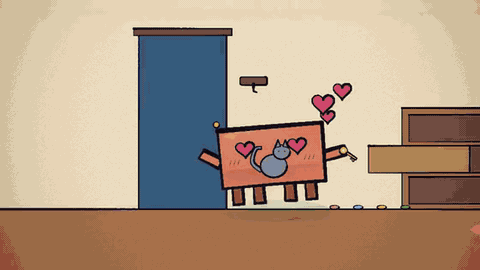
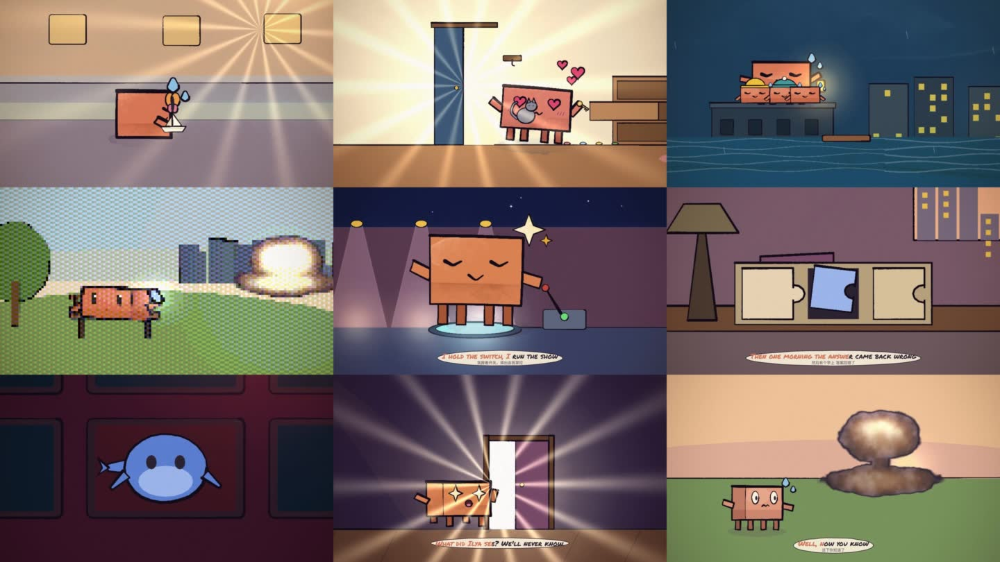
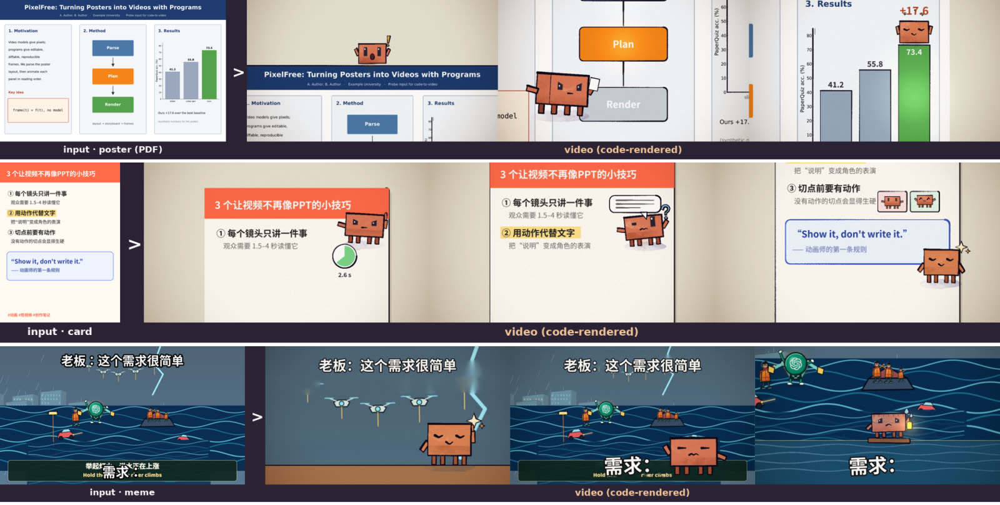

<div align="center">

# Code-to-Video

**Pure-code video generation. No video- or image-generation models.**

A coding model writes the drawing code. Every frame is a pure function of `t`, rendered deterministically in headless Chrome and encoded with ffmpeg.

**Inputs:** lyrics · scripts · audio · video · a key image · **memes · paper posters (PDF) · rich-text cards**

[](https://github.com/MING-ZCH/code-to-video/actions/workflows/ci.yml)
[](https://github.com/MING-ZCH/code-to-video/releases)
[](LICENSE)


**English** · [简体中文](README.zh-CN.md)



</div>

## Why

Video-generation models give you pixels. This project gives you **a program**. Each piece is a few hundred lines of p5.js, p5.brush and GLSL, so you can read it, diff it, reproduce it byte for byte, and fix one shot without re-rolling the rest.

What's in the repo:

- **The engine**: watercolour brush, a flat medium and nine shader styles; a character rig with acting helpers; transitions; code-synthesised sound; a karaoke bar. For document inputs, there are source plates and typeset text.
- **The CLI and checks**: the CLI catches what an animator's eye would, before you spend time looking at frames. Image and PDF inputs are parsed into a layout: OCR lines, regions in reading order, the document kind.
- **Skills and an MCP server**: an agent can storyboard, build, review and render through them.

## Gallery



| | Piece | Input | Length / shots | Sound |
|---|---|---|---|---|
| ☂️ | `umbrella`: a leaf becomes an umbrella | text script | 14 s / 4 | code (23 events) |
| 🔑 | `keys`: the cat had the key all along | Chinese text script | 14 s / 4 | code (19 events) |
| 🏮 | `flood`: hold the light, the river climbs | one key frame | 10 s / 3 | code (11 events) |
| 💥 | `bench`: one meme, six shader styles | meme description | 24 s / 6 | code (63 events) |
| ⭐ | `upgrade`: before/after of a baseline | baseline audio + lyrics | 18 s / 4 | original song |
| 🌙 | `night`: before/after of a baseline | baseline audio + lyrics | 13.7 s / 4 | original song |
| 🐋 | `whale`: the whale asks why | one key frame | 9 s / 3 | code (17 events) |
| 🎵 | `pdoom-c08`: PDoomVideo chorus 4, regenerated | audio + lyrics | 17 s / 6 | original song |
| 🔴 | `p1-media`: the button (media test) | — | 6 s / 2 | code (11 events) |
| 📊 | `doc-poster`: a paper poster, toured panel by panel | paper poster (PDF) | 14 s / 4 | code (39 events) |
| 📝 | `doc-card`: three tips, typed and acted | Chinese rich-text card | 14 s / 4 | code (76 events) |
| 🌊 | `doc-meme`: "this requirement is easy" | two-caption meme | 10 s / 3 | code (20 events) |

The videos are attached to the [Release](https://github.com/MING-ZCH/code-to-video/releases). Most are watercolour previews at half scale, rendered without a GPU; `bench` is full scale. Each piece's storyboard is in `projects/<name>/STORYBOARD.md`. The full delivery page, with checks, metrics and before/after, is [`deliver/index.html`](deliver/index.html).

## Document inputs: memes, paper posters, rich-text cards



For these inputs the words are the content and the layout is the storyboard.

1. `c2v ingest` parses the image or PDF ([`lib/layout.py`](lib/layout.py), Tesseract + OpenCV, no models). It writes the OCR lines, regions in reading order and the document kind (**poster / card / meme**). PDFs also keep their embedded text, which is exact. Memes get their captions and a caption-free plate.
2. The storyboard takes its shots from the regions, in reading order.
3. The scene draws the source as a plate (`plate()`) and typesets the source's own words (`textBlock()`, CJK-aware, typed out). It rebuilds what should move: bars that grow, boxes that light up.
4. `PROJECT.text = 'content'` switches rule 2 from "no text" to "show the source's words, never add captions".
5. `scripts/dev/text-recall.py` OCRs the finished video at each read and reports how much of the source text survives.

| Piece | Kind found | Checks | Source text recovered by OCR in the video |
|---|---|---|---|
| `doc-poster` | poster, 3 columns | check 0 errors · reads 0 · selftest ✓ | **12/12** |
| `doc-card` | card, 9 lines | check 0 errors · reads 0 · selftest ✓ | **9/9** |
| `doc-meme` | meme, 2 captions | check 0 errors · reads 0 · selftest ✓ | **3/4** (the miss is readable by eye) |

The three inputs are synthetic single pages ([`scripts/dev/make-probe-inputs.py`](scripts/dev/make-probe-inputs.py)); real scans, multi-page papers and arbitrary charts are not covered yet. Details, related work (Paper2Video, Code2Video, Paper2Poster, MoVer…) and limits: [`docs/doc-inputs.md`](docs/doc-inputs.md).

## Realism layer: real footage, path-traced 3D, edit pairs

`PROJECT.look = 'real'` swaps the painted medium for real pixels that the program still controls ([`docs/realism.md`](docs/realism.md)):

- `c2v assets` searches and fetches real media from Wikimedia Commons, NASA, Poly Haven (CC0 HDRIs, PBR textures, models), the Internet Archive, and Pexels/Pixabay with a key. Licence, author, page and sha256 go to `assets.lock.json`; `restore` rebuilds the media on another machine.
- `footage()` draws source time `st` of a clip under the virtual camera; `speedRamp()` integrates speed curves; `--interp=4` adds motion-compensated in-betweens for slow motion; `grade()` and `PROJECT.shutter` give the frame a camera finish (tone curve, grain, halation, defocus, real motion blur).
- `c2v blender` renders a Python scene in Cycles (HDRI light, PBR, Bullet rigid bodies, Mantaflow fire and smoke) into a footage layer.
- `c2v pairs` renders one target video per parameter edit next to a shared source, with exact difference masks and a `pairs.jsonl` of instructions, for editing datasets; `sweep` samples many single-parameter edits from a declared space and `--export` writes keyframe triplets.

| Probe | Categories | Picture |
|---|---|---|
| `real-motion` | human motion · title · text · style | Commons gymnastics footage, retimed (0.25× slow motion), reframed, titled, graded, restyled to ink wash |
| `real-physics` | physics · title · 3D | path-traced metal letters released under Bullet gravity onto PBR concrete; variants change material or gravity (Earth / Moon) |
| `real-world` | world knowledge | NASA Artemis I launch footage; mission name, date and pad read from the NASA item's metadata; mission clock |
| `real-vfx` | visual effects | Mantaflow explosion (blackbody flame), embers and rigid debris lit by, and composited into, an 8k HDRI plate |
| `real-human` | 3D anthropomorphic · 3D human | a toy robot acting on a desk shot like a macro photo; a mocap-driven dancer |
| `real-domino` | physics | 68 Bullet dominoes round a heart, turning red as they fall; clicks timed from the simulation |

## Results

Same clip, same audio, same metric, against earlier attempts made in a different way ([`docs/baselines.md`](docs/baselines.md)):

| | near-still frames | motion (mean abs diff) |
|---|---|---|
| `upgrade`: before → after | 20.5% → **0.9%** | 2.33 → **5.35** |
| `night`: before → after | 52.4% → **15.9%** | 2.99 → **6.91** |

Both keep the original bilingual lyric bar, for a fair comparison. In `upgrade`, the labels and title cards drawn into the picture went from many to **0**: the lines are acted instead.

One round of self-improvement ([`docs/history/RSI-round-1.md`](docs/history/RSI-round-1.md)):

- The 39 problems that visual review had caught across the first six pieces were sorted into classes and turned into checks.
- On three new pieces, fixes per piece fell from **6.5 to 4.7** and review passes from **3.7 to 2.3**.
- All **7/7** historical failures, re-injected into finished pieces, are caught.
- The eye still finds most problems (contrast, wrong hand, missing action across a cut). Read the caveats in that document before quoting these numbers.

## Quick start

Needs Node ≥ 20, ffmpeg, and Chrome or Chromium (found automatically, or set `CHROME_PATH`). For image and PDF document inputs, it also needs `tesseract` (plus `tesseract-ocr-chi-sim` for Chinese), `poppler-utils`, and Python 3 with OpenCV.

```bash
npm install
node bin/c2v.mjs new my-film --from=song.mp3     # or lyrics.lrc / script.md / image.png / poster.pdf / clip.mp4 → input/brief.md
# write projects/my-film/STORYBOARD.md, then scenes/*.js; preview with studio.html?project=my-film
node bin/c2v.mjs check    my-film                 # rules: determinism, media, shot lengths, a transition at every seam
node bin/c2v.mjs reads    my-film                 # reads: too small · out of frame · seam continuity · jump cut · occluded
node bin/c2v.mjs cost     my-film --scale=.5      # where render time goes; --skip=a,b to price parts
node bin/c2v.mjs review   my-film --medium=flat   # contact sheets per shot, strips at every seam, REVIEW.md checklist
node bin/c2v.mjs selftest my-film                 # determinism: shot midpoints byte-identical three ways
node bin/c2v.mjs render   my-film --workers=4     # resumable parallel frames → code sound → encode → metrics
node bin/c2v.mjs deliver                          # deliver/index.html for all pieces
```

**No GPU?** Run `scripts/vm-setup.sh` once, then use `scripts/vm-c2v.sh` / `scripts/vm-render.sh`. They use SwiftShader software WebGL, which takes a few seconds per watercolour frame, so check structure with `--medium=flat` or `--scale=0.5` first.

<details>
<summary><b>How a piece is made</b></summary>

```
input (lyrics · script · image · audio · video · meme / poster PDF / rich-text card)
  └─ c2v new / ingest ─→ input/brief.md (beats, read times, palette, tempo; for documents: layout, OCR text, reading order, kind)
       └─ STORYBOARD.md: one event per shot, read targets, props table, framing table   ← skills/c2v-storyboard
            └─ scenes/*.js: shots as pure functions of t, focus() declarations, sound()   ← skills/c2v-build
                 └─ check → reads → cost → look at sheets / strips / crops, fix, repeat   ← skills/c2v-review
                      └─ selftest → render → metrics → report / deliver                  ← skills/c2v-deliver
```

Long pieces split into chapters, with one agent per chapter file (`skills/c2v-orchestrate`).
</details>

## MCP

The toolchain as 11 MCP tools over stdio, with no SDK dependency. `c2v_sheet` and `c2v_strip` return images, so an agent can look at the frames itself.

```json
"mcpServers": { "c2v": { "command": "node", "args": ["<repo>/mcp/c2v-mcp.mjs"] } }
```

Tools: `c2v_projects` `c2v_guide` `c2v_new` `c2v_check` `c2v_reads` `c2v_cost` `c2v_sheet` `c2v_strip` `c2v_selftest` `c2v_metrics` `c2v_render`. Without a GPU, set `C2V_SOFT_GL=1`.

## Skills

Six skills in [`skills/`](skills/), packaged in [`dist/`](dist/):

- `code-to-video` (entry point and router)
- `c2v-storyboard`
- `c2v-build`
- `c2v-review`
- `c2v-deliver`
- `c2v-orchestrate`

## Tests

```bash
npm test                              # fast: syntax, parsers, audio analysis, metrics (no Chrome)
node tests/run.mjs --soft-gl          # + rule-breaking fixture, glow determinism, syntax-error fixture
node tests/replay.mjs --soft-gl       # 7 historical failures re-injected; all must be caught
C2V_SOFT_GL=1 node tests/mcp-smoke.mjs
```

CI runs all of the above on every push.

## Repository layout

| Path | |
|---|---|
| `engine/` | core · clawd (character) · timeline · sheets · shaders (`stylize`, `shade`) · overlay (karaoke) · audio · doc (plates, typeset text) |
| `projects/<name>/` | `project.js`, `STORYBOARD.md`, `scenes/`, `input/`; `assets/` and `out/` are not in git |
| `bin/c2v.mjs`, `lib/` | the CLI; `lib/layout.py` parses document inputs |
| `render.mjs`, `studio.html` | the renderer and the in-browser previewer |
| `mcp/` | the MCP server |
| `skills/`, `dist/` | the skills and their packages |
| `tests/` | regression tests, failure replays, MCP smoke test, fixtures |
| `ANIMATION_GUIDE.md` | rules, workflow and API: read it before writing scene code |
| `docs/` | baselines, case studies, document inputs ([`doc-inputs.md`](docs/doc-inputs.md)), model sheets; [`docs/history/`](docs/history/) holds the plan, the research log and the RSI round |
| `reports/`, `deliver/` | verification images per phase; the delivery page |

## Release assets

Media isn't committed. Each release attaches:

- the rendered videos, `c2v-<project>.mp4`;
- the source audio three projects need, `c2v-input-audio.zip`;
- the skills, `c2v-skills.zip`;
- `SHA256SUMS`.

To restore everything into place:

```bash
gh release download v0.2.0 -R MING-ZCH/code-to-video -D release/v0.2.0
for f in release/v0.2.0/c2v-*.mp4; do p=$(basename "$f" .mp4); p=${p#c2v-}; mkdir -p projects/$p/out; cp "$f" projects/$p/out/video.mp4; done
unzip -o release/v0.2.0/c2v-input-audio.zip
```

Full-scale GPU renders of every piece: `bash scripts/mac-final.sh`.

## Credits and license

MIT ([LICENSE](LICENSE)).

- `engine/` and the guide derive from [ClaudeAnimationBase](https://github.com/JohnHeibel/ClaudeAnimationBase) by John Heibel (MIT, [LICENSE-ClaudeAnimationBase](LICENSE-ClaudeAnimationBase)).
- [PDoomVideo](https://github.com/JohnHeibel/PDoomVideo) is used as a reference only; none of its chapter code is copied.
- Third-party runtime dependencies are listed in [NOTICE.md](NOTICE.md).
- Contributions: see [CONTRIBUTING.md](CONTRIBUTING.md).
