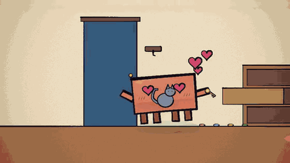
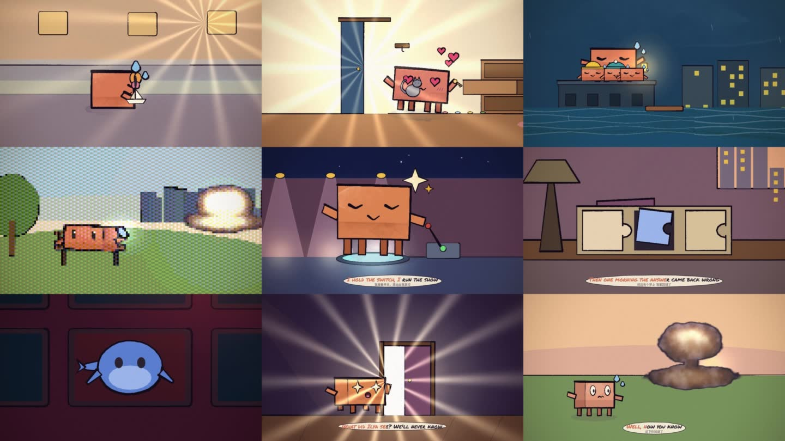
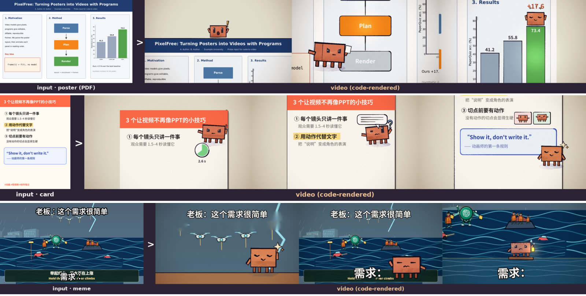

<div align="center">

# Code-to-Video

**纯代码生成视频：不调用任何视频或图像生成模型。**

由编码模型编写绘制代码，每帧都是时间 `t` 的纯函数，在 headless Chrome 中逐帧确定性渲染，再由 ffmpeg 编码成片。

**支持的输入：** 歌词 · 脚本 · 音频 · 视频 · 关键帧图片 · **meme 图 · 学术论文 poster（PDF）· 富文本图**

[](https://github.com/MING-ZCH/code-to-video/actions/workflows/ci.yml)
[](https://github.com/MING-ZCH/code-to-video/releases)
[](LICENSE)


[English](README.md) · **简体中文**



</div>

## 为什么

视频生成模型给的是像素，这个项目给的是**程序**。每部作品是几百行 p5.js、p5.brush 和 GLSL：能读、能 diff、能逐字节复现，也能只改一个镜头而不重抽其余部分。

仓库包含三部分：

- **引擎**：水彩笔刷、扁平媒介、9 种 shader 风格；带表演助手的角色；转场；代码合成的声音；卡拉 OK 歌词条；文档类输入可用的原图素材与排版文字。
- **CLI 与机检**：在看帧之前，先自动查出动画师肉眼会发现的问题。图片和 PDF 输入会被解析成版面：OCR 文字、按阅读顺序排列的区块、文档类型。
- **Skills 和 MCP 服务**：agent 可以通过它们完成分镜、构建、核验与渲染。

## 作品



| | 作品 | 输入 | 时长 / 镜头 | 声音 |
|---|---|---|---|---|
| ☂️ | `umbrella`：一片叶子成了伞 | 文本脚本 | 14 s / 4 | 代码（23 个事件） |
| 🔑 | `keys`：钥匙一直在猫那儿 | 中文脚本 | 14 s / 4 | 代码（19） |
| 🏮 | `flood`：举起灯火，洪水在涨 | 一张关键帧 | 10 s / 3 | 代码（11） |
| 💥 | `bench`：一张梗图，六种 shader 风格 | 梗图描述 | 24 s / 6 | 代码（63） |
| ⭐ | `upgrade`：基线的 before/after | 基线音频 + 歌词 | 18 s / 4 | 原曲 |
| 🌙 | `night`：基线的 before/after | 基线音频 + 歌词 | 13.7 s / 4 | 原曲 |
| 🐋 | `whale`：鲸鱼问为什么 | 一张关键帧 | 9 s / 3 | 代码（17） |
| 🎵 | `pdoom-c08`：重生成 PDoomVideo 合唱 4 | 音频 + 歌词 | 17 s / 6 | 原曲 |
| 🔴 | `p1-media`：按钮（媒介测试） | — | 6 s / 2 | 代码（11） |
| 📊 | `doc-poster`：逐栏巡游一张论文 poster | 论文 poster（PDF） | 14 s / 4 | 代码（39） |
| 📝 | `doc-card`：三条技巧，边打字边表演 | 中文富文本图 | 14 s / 4 | 代码（76） |
| 🌊 | `doc-meme`：“这个需求很简单” | 双字幕 meme 图 | 10 s / 3 | 代码（20） |

成片在 [Release](https://github.com/MING-ZCH/code-to-video/releases) 附件中。大多数是在无 GPU 环境下渲染的半分辨率水彩预览，`bench` 为全分辨率。分镜见各项目的 `projects/<name>/STORYBOARD.md`，含检查、指标和 before/after 的完整交付页见 [`deliver/index.html`](deliver/index.html)。

## 文档类输入：meme 图、论文 poster、富文本图



这类输入里，文字就是内容，版面就是分镜。

1. `c2v ingest` 解析图片或 PDF（[`lib/layout.py`](lib/layout.py)，Tesseract + OpenCV，不用模型），输出 OCR 文字行、按阅读顺序排列的区块和文档类型（**poster / card / meme**）。PDF 同时保留内嵌文字（精确无误）；meme 额外拆出字幕，并生成去字底图。
2. 分镜按阅读顺序把区块逐个排成镜头。
3. 场景把原图当素材（`plate()`），排出原文文字（`textBlock()`，支持中文，可逐字打出），并把该动的部分重建成会动的对象：长高的柱子、亮起的方框。
4. `PROJECT.text = 'content'` 把规则 2 从“画面不放字”改为“只展示原文的字，不加说明字”。
5. `scripts/dev/text-recall.py` 在成片的每个读点做 OCR，统计原文有多少还能被认出来。

| 作品 | 识别类型 | 检查 | 成片中被 OCR 认出的原文 |
|---|---|---|---|
| `doc-poster` | poster，3 栏 | check 0 错误 · reads 0 · selftest ✓ | **12/12** |
| `doc-card` | 富文本卡，9 行 | check 0 错误 · reads 0 · selftest ✓ | **9/9** |
| `doc-meme` | meme，2 条字幕 | check 0 错误 · reads 0 · selftest ✓ | **3/4**（漏掉的一条人眼可读） |

三个输入都是合成的单页样例（[`scripts/dev/make-probe-inputs.py`](scripts/dev/make-probe-inputs.py)）；真实扫描件、多页论文和任意图表还没覆盖。细节、相关工作（Paper2Video、Code2Video、Paper2Poster、MoVer 等）与局限见 [`docs/doc-inputs.md`](docs/doc-inputs.md)。

## 结果

与早期尝试做同口径对比：同一片段、同一音频、同一指标（[`docs/baselines.md`](docs/baselines.md)）。

| | 近静止帧 | 运动量（逐帧均差） |
|---|---|---|
| `upgrade`：before → after | 20.5% → **0.9%** | 2.33 → **5.35** |
| `night`：before → after | 52.4% → **15.9%** | 2.99 → **6.91** |

为保证公平，两者都保留了原片的双语歌词条。`upgrade` 画面中的标签和标题卡从很多处降到了 **0**，改成由角色把每句词演出来。

自我迭代第 1 轮（[`docs/history/RSI-round-1.md`](docs/history/RSI-round-1.md)）：

- 把前 6 部作品中靠肉眼发现的 39 个问题归类，做成了机检规则。
- 在 3 部新作品上，平均每部的修复数从 **6.5** 降到 **4.7**，核验轮数从 **3.7** 降到 **2.3**。
- 把 **7 个**历史失败注入已完成的作品，全部被抓到。
- 大部分问题仍要靠肉眼发现（对比度、拿错手、切点前缺动作）。引用这些数字前，请先读该文档里的局限说明。

## 快速开始

需要 Node ≥ 20、ffmpeg，以及 Chrome 或 Chromium（自动查找，也可以设置 `CHROME_PATH`）。图片和 PDF 文档输入还需要 `tesseract`（中文另装 `tesseract-ocr-chi-sim`）、`poppler-utils`，以及带 OpenCV 的 Python 3。

```bash
npm install
node bin/c2v.mjs new my-film --from=song.mp3     # 或 lyrics.lrc / script.md / image.png / poster.pdf / clip.mp4 → input/brief.md
# 先写 projects/my-film/STORYBOARD.md，再写 scenes/*.js；用 studio.html?project=my-film 预览
node bin/c2v.mjs check    my-film                 # 规则：确定性、媒介、镜头时长、每个接缝都有转场
node bin/c2v.mjs reads    my-film                 # 读点：过小 · 出画 · 跨切点连续性 · 跳切 · 被遮挡
node bin/c2v.mjs cost     my-film --scale=.5      # 渲染耗时花在哪；--skip=a,b 给部件计价
node bin/c2v.mjs review   my-film --medium=flat   # 每镜头 sheet、每个接缝 strip、REVIEW.md 清单
node bin/c2v.mjs selftest my-film                 # 确定性：镜头中点三路逐字节一致
node bin/c2v.mjs render   my-film --workers=4     # 可续渲的并行帧 → 代码声音 → 编码 → 指标
node bin/c2v.mjs deliver                          # 生成全部作品的 deliver/index.html
```

**没有 GPU？** 先运行一次 `scripts/vm-setup.sh`，之后用 `scripts/vm-c2v.sh` / `scripts/vm-render.sh`。它们走 SwiftShader 软件 WebGL，水彩每帧要几秒，所以先用 `--medium=flat` 或 `--scale=0.5` 检查结构。

<details>
<summary><b>一部作品是怎么做出来的</b></summary>

```
输入（歌词 · 脚本 · 图像 · 音频 · 视频 · meme / poster PDF / 富文本图）
  └─ c2v new / ingest ─→ input/brief.md（节拍、读点时长、调色板、速度；文档类另有版面、OCR 文字、阅读顺序、类型）
       └─ STORYBOARD.md：每镜头一个事件，加读点目标表、道具表、景别表    ← skills/c2v-storyboard
            └─ scenes/*.js：镜头是 t 的纯函数，focus() 声明，sound()   ← skills/c2v-build
                 └─ check → reads → cost → 看 sheet / strip / crop，修，再看  ← skills/c2v-review
                      └─ selftest → render → metrics → report / deliver ← skills/c2v-deliver
```

长片按章节拆分，每个章节文件由一个 agent 负责（`skills/c2v-orchestrate`）。
</details>

## MCP

把工具链作为 11 个 MCP 工具暴露（stdio，无 SDK 依赖）。`c2v_sheet` 和 `c2v_strip` 直接返回图片，agent 可以自己看画面。

```json
"mcpServers": { "c2v": { "command": "node", "args": ["<repo>/mcp/c2v-mcp.mjs"] } }
```

工具：`c2v_projects` `c2v_guide` `c2v_new` `c2v_check` `c2v_reads` `c2v_cost` `c2v_sheet` `c2v_strip` `c2v_selftest` `c2v_metrics` `c2v_render`。没有 GPU 时设置环境变量 `C2V_SOFT_GL=1`。

## Skills

[`skills/`](skills/) 里有 6 个 skill，打包在 [`dist/`](dist/)：

- `code-to-video`（入口与路由）
- `c2v-storyboard`
- `c2v-build`
- `c2v-review`
- `c2v-deliver`
- `c2v-orchestrate`

## 测试

```bash
npm test                              # 快速：语法、解析器、音频分析、指标（不启动 Chrome）
node tests/run.mjs --soft-gl          # 再加规则违例 fixture、glow 确定性、语法错误 fixture
node tests/replay.mjs --soft-gl       # 注入 7 个历史失败，必须全部被抓到
C2V_SOFT_GL=1 node tests/mcp-smoke.mjs
```

CI 在每次 push 时运行以上全部测试。

## 目录结构

| 路径 | |
|---|---|
| `engine/` | core · clawd（角色） · timeline · sheets · shaders（`stylize`、`shade`） · overlay（歌词条） · audio · doc（原图素材、排版文字） |
| `projects/<name>/` | `project.js`、`STORYBOARD.md`、`scenes/`、`input/`；`assets/` 与 `out/` 不入 git |
| `bin/c2v.mjs`、`lib/` | CLI；`lib/layout.py` 解析文档类输入 |
| `render.mjs`、`studio.html` | 渲染器与浏览器内预览器 |
| `mcp/` | MCP 服务 |
| `skills/`、`dist/` | skills 及其打包 |
| `tests/` | 回归测试、失败回放、MCP 冒烟、fixture |
| `ANIMATION_GUIDE.md` | 规则、工作流与 API：写场景代码前必读 |
| `docs/` | 基线、案例、文档类输入（[`doc-inputs.md`](docs/doc-inputs.md)）、模型表；[`docs/history/`](docs/history/) 存放计划、实验日志与 RSI 轮次 |
| `reports/`、`deliver/` | 各阶段核验图；交付页 |

## Release 资产

媒体文件不提交。每个 Release 附带：

- 成片 `c2v-<project>.mp4`；
- 3 个项目需要的源音频 `c2v-input-audio.zip`；
- skills 包 `c2v-skills.zip`；
- 校验和 `SHA256SUMS`。

一键放回原位：

```bash
gh release download v0.2.0 -R MING-ZCH/code-to-video -D release/v0.2.0
for f in release/v0.2.0/c2v-*.mp4; do p=$(basename "$f" .mp4); p=${p#c2v-}; mkdir -p projects/$p/out; cp "$f" projects/$p/out/video.mp4; done
unzip -o release/v0.2.0/c2v-input-audio.zip
```

在 GPU 上全分辨率重渲全部作品：`bash scripts/mac-final.sh`。

## 致谢与许可

MIT（[LICENSE](LICENSE)）。

- `engine/` 与 guide 派生自 John Heibel 的 [ClaudeAnimationBase](https://github.com/JohnHeibel/ClaudeAnimationBase)（MIT，见 [LICENSE-ClaudeAnimationBase](LICENSE-ClaudeAnimationBase)）。
- [PDoomVideo](https://github.com/JohnHeibel/PDoomVideo) 仅作参照，没有复制其章节代码。
- 第三方运行时依赖见 [NOTICE.md](NOTICE.md)。
- 参与贡献请看 [CONTRIBUTING.md](CONTRIBUTING.md)。
