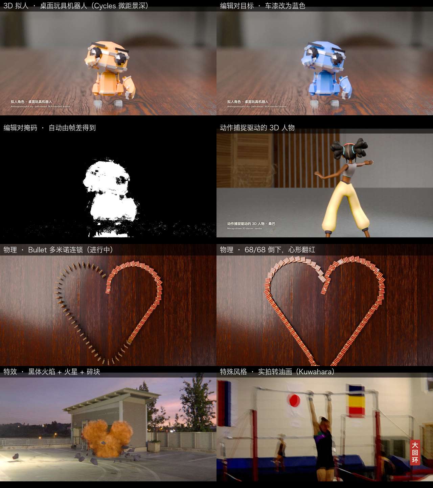

# Realism layer

The 2D engine draws everything from code, which is what makes it controllable, and also why every piece looks like
an animation: characters are geometric or cartoon, with no skin, hair or cloth, and physics and effects are procedural
approximations. This layer keeps the program as the source of truth and changes what the program composes:

| Source of pixels | What it covers | How it stays controllable |
|---|---|---|
| **Real footage and photos** from public libraries (`c2v assets`) | real people moving, real places, real objects; world knowledge from real sources | code picks the source frames (`footage(name, st)`), retimes them (`speedRamp`), reframes them (virtual camera), cuts, composites, types over and grades them |
| **Path-traced 3D** (Blender Cycles, `c2v blender`) | PBR materials, HDRI lighting, rigid bodies, gas (fire/smoke), 3D type | a Python scene file + params → a frame sequence, registered as footage; physical inputs (gravity, material, mass) are params |
| **Camera finish** (`grade()`, `PROJECT.shutter`) | what makes a frame read as photographed: motion blur, tone curve, grain, halation, aberration, defocus, letterbox | uniforms driven by `t` and params |

Frames are still pure functions of `(t, params)`: `selftest` passes on footage + motion-interpolated slow motion +
sub-frame motion blur + grade + stylize (see the research log).



## Workflow

```bash
# 1. find and fetch real media (licence, author, page and sha256 go to projects/<p>/assets.lock.json, which is committed)
node bin/c2v.mjs assets my-film search wikimedia gymnastics          # also: nasa, polyhaven (--type=hdri|texture|model), archive, pexels*, pixabay*
node bin/c2v.mjs assets my-film fetch "wikimedia:<File title>" --as=clip --fps=24 --w=1920 [--start=9.6 --dur=2 --interp=4]
node bin/c2v.mjs assets my-film credits                              # attribution lines for the description
node bin/c2v.mjs assets my-film restore                              # re-fetch on another machine; refuses changed downloads

# 2. path-traced layers (optional)
node bin/c2v.mjs blender my-film projects/my-film/blender/scene.py --as=layer --params='{"gravity":1.62}' [--scale=.5 --samples=32 --only=1,60]

# 3. the scene: PROJECT = { look: 'real', footage: true, shutter: { samples: 4, angle: .5 }, params: {...} }
#    footage('clip', st, x, y, w, h, { smooth, blend, key, src }) · grade({...}) · handheld(t) · speedRamp(lt, keys)

# 4. edit pairs
node bin/c2v.mjs pairs my-film                                       # projects/my-film/pairs.json → out/pairs/{source,<id>}.mp4, masks, pairs.jsonl
```

`*` needs `PEXELS_API_KEY` / `PIXABAY_API_KEY` in the environment.

## Edit pairs

An edit is a parameter override, so the source and target videos come from the same program and differ only where the
parameter reaches. Because frames are deterministic, untouched pixels are identical and the frame difference is an exact
edit mask (at JPEG-block precision). Each line of `pairs.jsonl`:

```json
{"id":"title_text","edit_type":"text_replace","instruction_zh":"…","instruction_en":"…","source":"source/video.mp4","target":"title_text/video.mp4",
 "mask":"title_text_mask.mp4","params_source":{},"params_target":{"title_zh":"女子高低杠"},"frames":240,"changed_frames":85,"changed_ratio_mean":0.009}
```

Edit types that come for free from a program: colour grade, text content and style, speed (slow motion on/off), camera
(push-in on/off), style transfer (ink wash / halftone / oil / none), and, through Blender layers, material, paint colour,
lighting and physical constants (gravity, friction, restitution). `changed_frames` and `changed_ratio_mean` let a dataset
filter local vs global edits.

**Sweeps.** `pairs.json` may declare a parameter space and instruction templates; `c2v pairs` then samples single-parameter
edits with a fixed seed (deduplicated against the hand-written ones), so the instruction stays exact:

```json
"sweep": { "n": 16, "seed": 7,
  "space": { "temp": { "range": [-0.6, 0.6], "step": 0.3 }, "style": { "values": ["halftone", "cel", "none"] } },
  "templates": { "style": { "type": "style", "zh": "把结尾的水墨风格改为{v}。", "en": "Change the closing style to {v}.",
                            "names": { "cel": ["赛璐璐卡通风格", "a cel-shaded cartoon"] } } } }
```

Masks come from a fixed difference threshold, so they are exact for local edits and under-cover subtle global ones (a
small colour-temperature shift marks 0.1 % of the frame): for global edits, the parameter diff is the label.
`--list` prints the edits without rendering; `--export --keyframes=4` also writes source / target / mask keyframe
triplets (picked among the frames the edit changed) under `out/pairs/keyframes/` and lists them in `pairs.jsonl`, for
image-editing training.

## What each probe shows

| Project | Categories | Real sources | Code controls |
|---|---|---|---|
| `real-motion` | human motion, text, title sequence, special style | Wikimedia Commons footage (CC BY-SA 3.0) | source time (0.5× → 1× → 0.25× → 1×), motion-interpolated slow motion, virtual push-in and hand-held drift, title with focus pull, lower third, grade, ink-wash restyle, seal |
| `real-physics` | physics, title sequence, 3D | Poly Haven HDRI + PBR concrete (CC0) | Bullet rigid bodies, timed releases, material, gravity, camera crane, caption that must match the simulated gravity |
| `real-vfx` | visual effects | Poly Haven 8k HDRI plate (CC0) | Mantaflow fire (blackbody colour from the flame grid) and smoke, ember particles, rigid debris pushed by a one-frame force, shadow catcher, locked-off camera + rotation-only shake in the composite |
| `real-human` | 3D anthropomorphic, 3D human motion | RobotExpressive (CC0), Michelle + samba mocap (Mixamo via three.js), Poly Haven HDRI + PBR | NLA-blended actions, materials restyled to painted plastic / satin metal, toy scale + 85 mm f/2 (miniature photography), paint colour and key light as params |
| `real-domino` | physics | Poly Haven plywood / wood table / HDRI | Bullet dominoes on a heart built from arcs and tangents (a sharp tip stops the chain), two-sided material that turns red as it falls, clicks timed from the simulation's own impact frames (`measure()`), friction / restitution as params |

**Measured physics.** A Blender scene may define `measure(ctx)`; it runs after the bake and its result lands in the layer's
meta (`ASSET_META[layer].measure`), so the composite can time sound and captions from the simulation itself. The domino
scene records the frame each plaque tips past 60°: 68/68 fall, the wave runs at 22 plaques/s (≈ 1.4 m/s).

**Styles on real pixels.** `stylize('oil', { k, r })` (4-sector Kuwahara + canvas weave + impasto relief) and the other
styles apply to footage and Blender layers as they do to painted frames.

## Limits

- Real footage brings its own camera: a moving source camera rules out multi-frame tricks that need a locked-off shot
  (stroboscopic composites), and there is no camera tracking yet, so CG cannot be placed into moving footage.
- Public libraries are uneven: Commons has real people and places but few clean VFX elements (fire or sparks on black);
  Openverse was unreachable from this network; Pexels/Pixabay need a key.
- Realistic humans that act to a script are only partly covered: `real-human` drives a skinned character with real mocap
  and path-traces it, but the freely available rigged characters are stylised (Michelle) or toys (RobotExpressive);
  photoreal people need scanned, rigged humans (MPFB / MakeHuman CC0 assets, or SMPL-X under its research licence) plus
  mocap retargeting.
- Mantaflow at preview resolution reads as soft; convincing pyrotechnics need resolution ≥ 160 plus noise up-res and
  several minutes of bake per variant.
- Determinism is per machine (GPU, fonts, Blender version); the lock records the Blender version and the scene hash.
- Cycles' Metal kernel loader crashed twice (NSException) while the Chrome renderer shared the GPU; render Blender layers
  on their own (cause not established).

## Captured scenes rendered from code (`c2v splat`)

Real appearance can come from a capture instead of assets: photos → COLMAP poses → 3D Gaussian Splatting (e.g. Brush,
which trains on Apple Silicon) → `engine/splat.js`, a deterministic WebGL2 renderer (SH degree 3, EWA projection,
float-framebuffer blending, Brush's raster conventions). A scene module (`projects/splat-garden/splat/garden.mjs`) is
code: the camera path, recolouring and removal inside a region, and procedural splats added per frame.

```bash
node bin/c2v.mjs splat --eval --ply=<scene.ply> --colmap=<sparse/0> --images=<photos> --out=<dir>   # held-out views
node bin/c2v.mjs splat splat-garden projects/splat-garden/splat/garden.mjs --as=orbit --frames=240 --scale=.6667
```

On Mip-NeRF 360 garden (every 8th photo held out, 30k steps) the WebGL render scores 27.62 dB PSNR / 0.867 SSIM /
0.130 LPIPS on the held-out photos, the same as Brush's own renderer (65.4 dB apart) and in line with published 3DGS
results. Recolouring a region works as an edit pair; removal exposes surfaces never photographed, and inserted objects
need relighting.

## Interaction checks (contact, support, scale)

A single asset can look real while the shot still reads as fake: a hand that passes through a cup, a ball that sinks
into a table. Code scenes have explicit 3D state, so these are measured per frame and solved:

- `projects/cg-grasp/blender/grasp.py`: a contact solver moves the open hand out of the cup's volume (its convex hull,
  i.e. the mouth closed) and closes each finger joint until it is within 2 mm of the surface; `measure()` reports
  vertices inside the porcelain and inside the cup, fingertip gaps and the cup-table gap. A fixed grip pose on the
  same wrist path puts 158 vertices up to 29 mm inside the cup; the solved grip puts none.
- Inserted splats rest on the captured surface height estimated from nearby Gaussians
  (`scripts/dev/splat_scene_probe.py … <e1> <e2>`), not on a guessed plane.
- `C.fix_biped_tails` re-points FBX-imported 3ds Max Biped bones (Microsoft Rocketbox avatars) at the next joint so IK
  ends at the real wrist.

## Pure code, no capture: layout solving, renderer choice, rigid-body interaction

`projects/pc-still` lays out Poly Haven scans on a table three ways and measures each (`blender/still.py`, `measure()`):
by origin (`naive`), by origin with every asset normalised to 20 cm (`naive_scaled`), and solved (size priors, mesh
bottoms on supports, footprint separation, rest-pose prior, vertical sweep with minimum-potential-energy placement,
Bullet settling, then a check that the fruit stayed on the plate). Solved: 0 interpenetrating pairs (naive 6), support
gaps ≤ 0.9 mm, objects move ≤ 2.5 mm when gravity is switched on (naive: pieces thrown metres).

The solved scene exported to glTF renders in three.js (`c2v three --glb … --mode=raster|raster_gtao|pt`, `engine/three.js`):
image-based rasterisation has no contact shadows, so objects resting on the table look afloat (24.5 dB against a Cycles
reference; 20.8 dB around the contacts); three-gpu-pathtracer converges to Cycles (32.8 dB at 1024 spp) at about 12×
the cost. `c2v three <p> <scene.mjs> --as=<layer>` runs a Rapier (deterministic build) rigid-body shot and records the
deepest contact penetration per frame: 2.4 mm for a dropped apple versus 36.3 mm for the same move keyframed.

## People in code-built scenes (Rocketbox avatars + motion capture)

`C.drive_biped(avatar_rig, animation.fbx, anchor)` drives a Microsoft Rocketbox avatar with a Rocketbox animation:
the animation files are bound in another pose (thighs 66° apart from the avatars'), so each bone copies the animation
bone's world rotation instead of its local one; the performance is placed by moving `anchor`. `C.rocketbox_skin()`
sets up the avatars' photographic skin, normal, specular and hair-card alpha maps.

- `projects/film-cafe`: two seated people at the table layout solved in pc-still; each person is lifted to the floor,
  each chair scaled to the sitter's measured underside and slid to the offset with no person vertex inside it
  (0 vertices in chair or table, seat gaps within ±4 mm; the unsolved placement: 42 / 21 vertices in the chairs, feet
  21 mm into the floor).
- `projects/film-street`: a walk captured with forward travel is made in-place and cycled; the forward speed is solved
  from the planted feet (1.049 m/s against the capture's 1.035 m/s; foot slide 16 cm/s against 36 cm/s at a fixed
  1.4 m/s). The camera only rotates, which an HDRI background at infinity supports.
- `projects/film-pd`: live action from a public-domain film, cut by code with bilingual subtitles and the original
  sound laid back under the same cut list (`scripts/dev/mux_cuts_audio.mjs`).

`c2v render` reuses frames on disk only while project.js, the scenes and assets.lock.json are unchanged.
